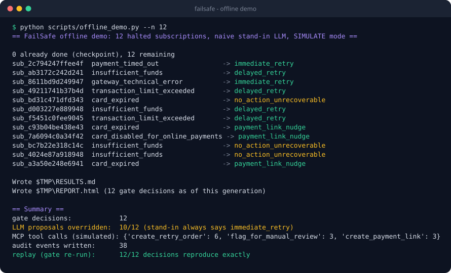
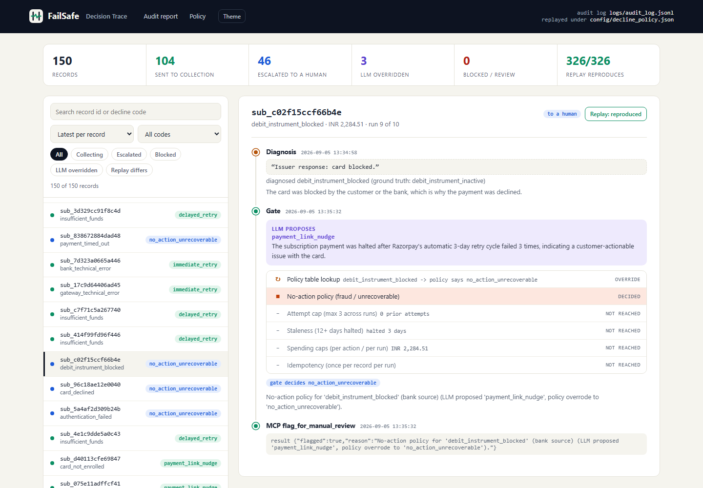
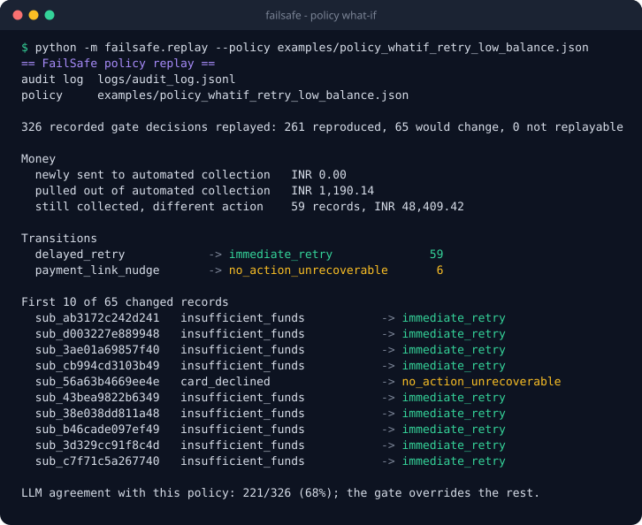
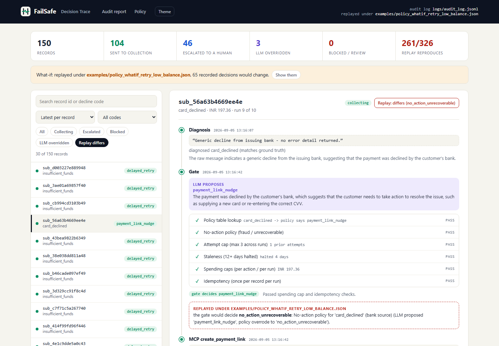
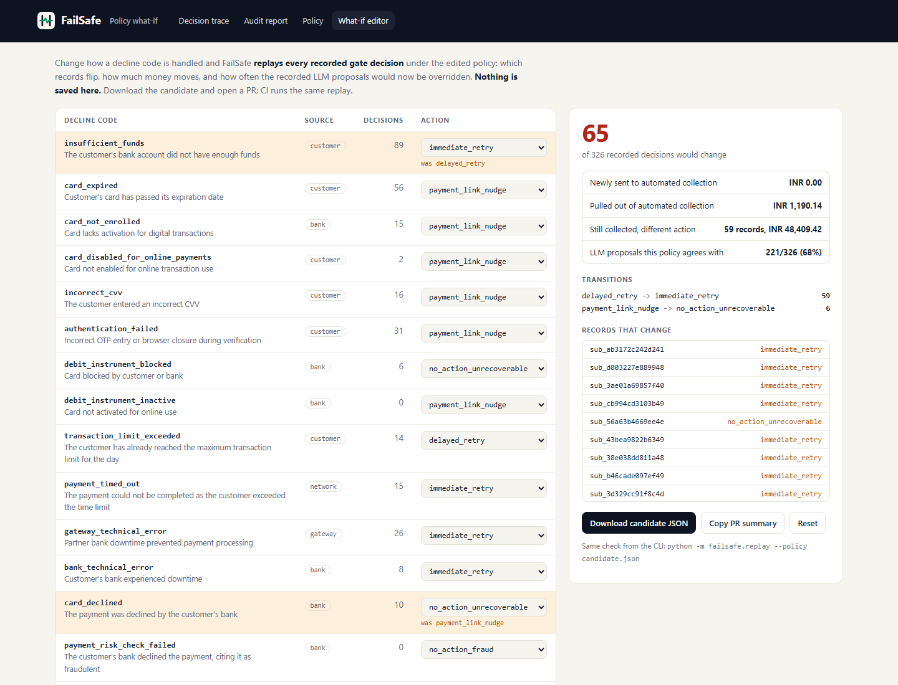

# FailSafe demo (3 minutes, fully offline)

Everything below runs with **no Ollama, no Razorpay keys and no network**. It uses the committed audit logs and a deliberately naive stand-in LLM. For the live-model version (Ollama + Razorpay test mode), see [DEMO_SCRIPT.md](DEMO_SCRIPT.md).

Setup, once:

```bash
python -m venv .venv && source .venv/bin/activate      # Windows: .venv\Scripts\Activate.ps1
pip install -e .                  # the failsafe package + its pinned deps
```

---

## 1. The agent runs, and the gate overrides it (0:00–0:40)

```bash
python scripts/offline_demo.py --n 12 --keep
```



> "This is the real batch loop: real gate, real policy file, a real in-process MCP server in SIMULATE mode, and a real audit log. The only fake is the LLM, a stand-in that always says *retry immediately*. Watch the gate overrule it 10 times out of 12. Some records go to a retry, some get a payment link, and the stale ones go to a human. On the last line, the gate is re-run over what it just did, and it reproduces 12 of 12 decisions."

`--keep` leaves `TRACE.html` and `REPORT.html` in the printed temp folder.

## 2. Open one decision and see why (0:40–1:30)

```bash
python -m failsafe.decision_trace          # -> TRACE.html (from logs/audit_log.jsonl, 150 records)
```

Open `TRACE.html` (double-click; it needs no server), or jump straight to the record: `TRACE.html#sub_c02f15ccf66b4e`.



> "Each payment is a timeline. Here the bank said *'card blocked'*. Diagnosis read it as `debit_instrument_blocked`, though the ground truth was *inactive*. The LLM proposed a payment link. The gate's first check, the policy table, disagrees. The second, the no-action policy, decides: send it to a human. The remaining four checks are never reached. The tool call is logged, and the badge top right says the gate, re-run today on these inputs, makes the same call."

Things to click: the **LLM overridden** chip (3 records), **Escalated** (46 records), the **Every run** view (329 decisions across 10 runs), and **Theme**.

## 3. Hand an auditor the incident report (1:30–1:50)

```bash
python -m failsafe.replay --record sub_c02f15ccf66b4e
```

> "That trace is also available as Markdown you can paste into a ticket: every run this record went through, each gate check, and a replay verdict at the bottom."

## 4. Change the policy and see the blast radius first (1:50–2:40)

A merchant wants to retry low-balance cards immediately instead of waiting for payday, and to stop chasing generic `card_declined`. The candidate policy is [`examples/policy_whatif_retry_low_balance.json`](examples/policy_whatif_retry_low_balance.json).

```bash
python -m failsafe.replay --policy examples/policy_whatif_retry_low_balance.json
```



> "Before this ships, FailSafe replays all 326 recorded decisions under the new policy. 65 would change: 59 move from a delayed retry to an immediate one (₹48,409 re-timed), and 6 card-declined customers stop getting a payment link (₹1,190 pulled out of collection). Also, the recorded LLM proposals would now be overridden 32% of the time instead of 2%, so the model and the policy disagree."

To see the same thing visually:

```bash
python -m failsafe.decision_trace --policy examples/policy_whatif_retry_low_balance.json --out WHATIF.html
```

Open `WHATIF.html?filter=changed`.



Or interactively: run `python -m failsafe.console` and open <http://127.0.0.1:8080/policy/edit>. Flip `insufficient_funds` to `immediate_retry` and watch the numbers update.



> "In CI this runs on every PR that touches the policy or the gate. The PR gets this summary, and the build fails if a gate change would silently rewrite past decisions."

## 5. It's a service, too (2:40–3:00)

```bash
python -m failsafe.console                  # http://127.0.0.1:8080
curl -s localhost:8080/api/replay | head
curl -s localhost:8080/api/record/sub_c02f15ccf66b4e
```

Or with Docker:

```bash
docker build -t failsafe . && docker run --rm -p 8080:8080 failsafe
```

> "The same pages are served by a read-only console that regenerates them when the audit log changes, plus a JSON replay API and a health check. One container runs both the console and the batch agent."

---

### Talking points

- **"The LLM proposes, the gate decides."** `src/failsafe/gate.py` makes no model calls. It runs six checks in a fixed order and stops at the first one that decides.
- **"Replay is exact, not statistical."** Only the gate is re-run; the model's recorded proposal is an input. This makes the replay deterministic, and it never calls Ollama or Razorpay.
- **"Honest numbers."** The data is synthetic and recoveries are simulated. The README and [docs/PRODUCT.md](docs/PRODUCT.md) say which numbers are measured and which are not.
