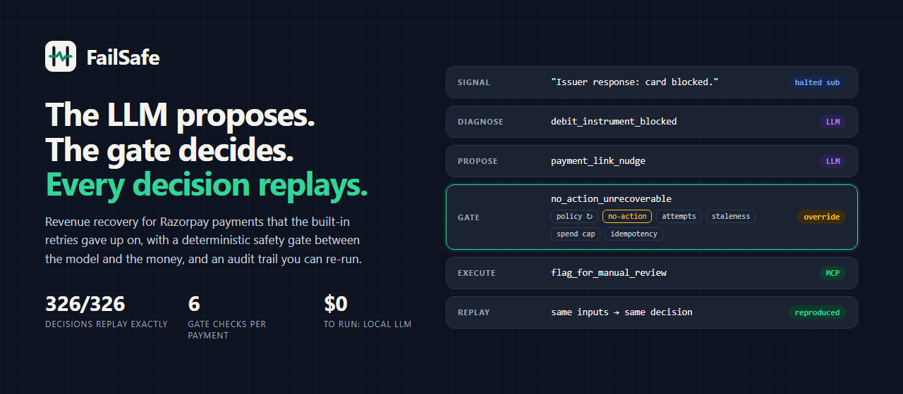
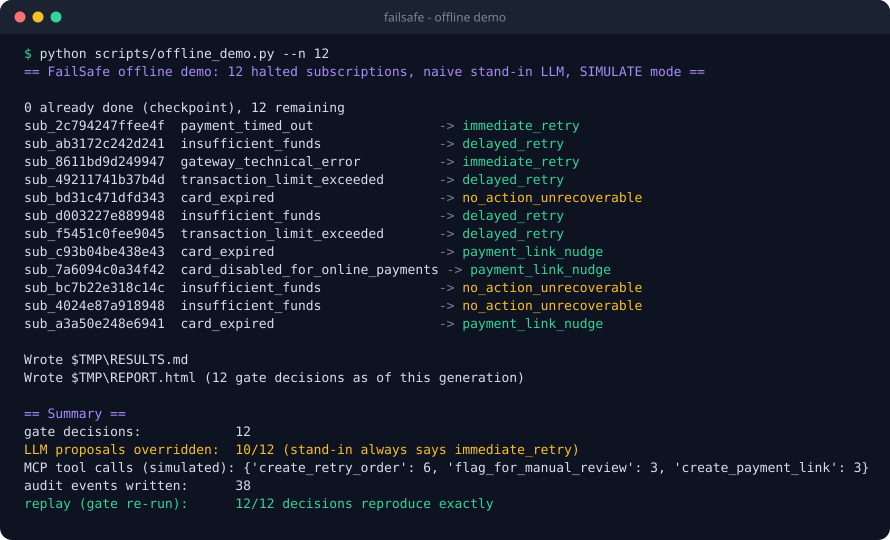
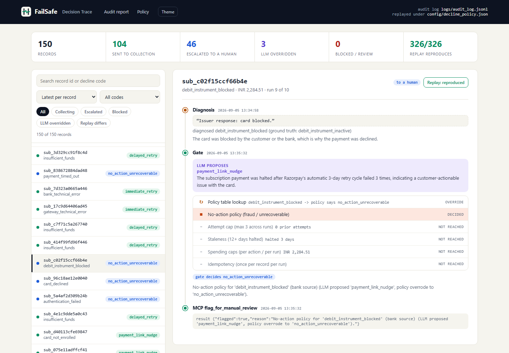
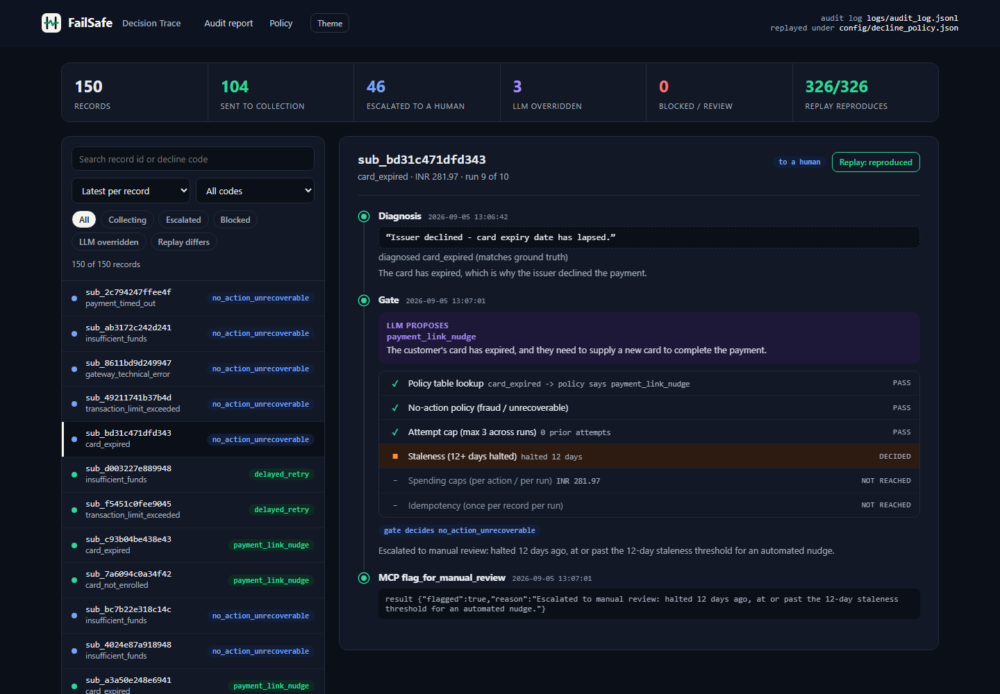
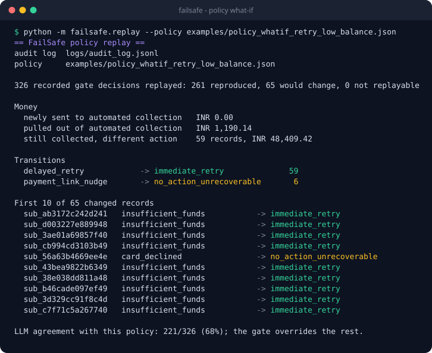
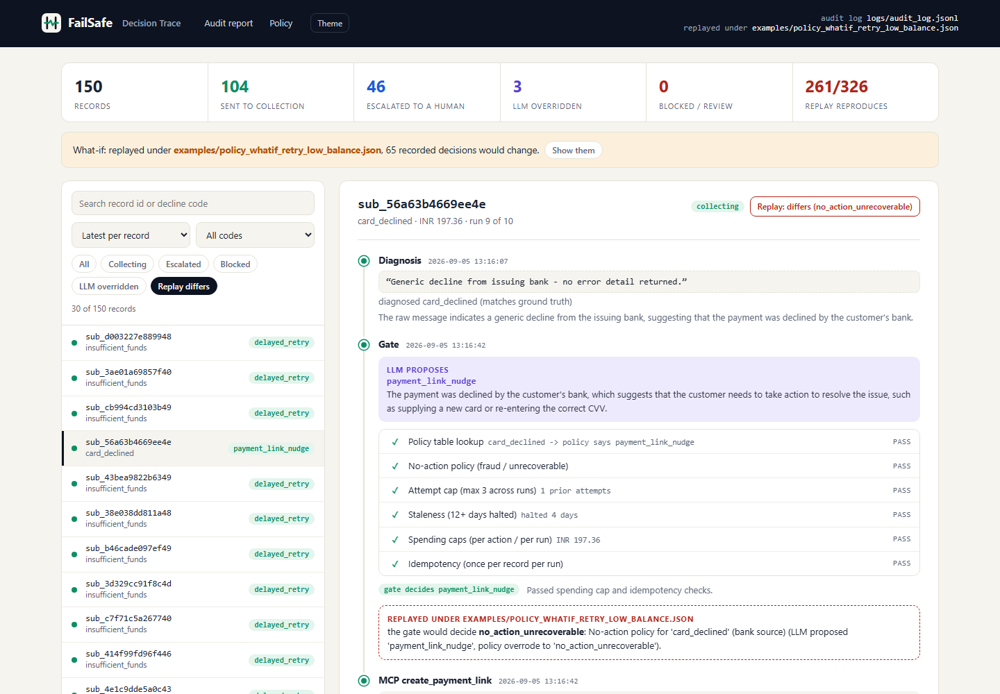
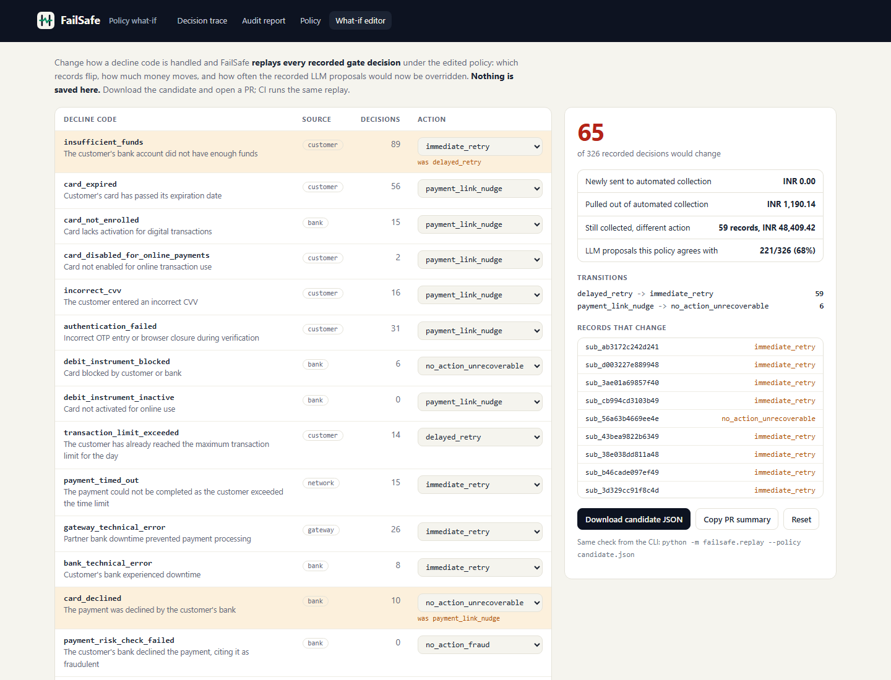
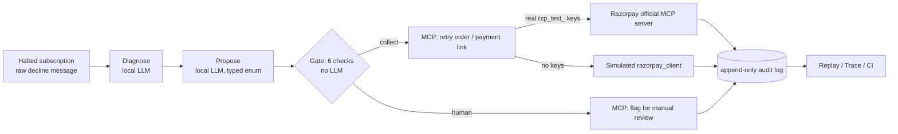

<p align="center"></p>

<p align="center"><b>The LLM proposes. The gate decides. Every decision replays.</b><br>
Revenue recovery for failed Razorpay payments, with a deterministic safety gate between the model and the money.</p>

<p align="center">
<a href="https://github.com/MrNK2107/FailSafe/actions/workflows/tests.yml"></a>
<a href="https://github.com/MrNK2107/FailSafe/actions/workflows/policy-check.yml"></a>


<a href="LICENSE"></a>
</p>

> **Track 3 — AI Revenue Recovery.** A gated, audited, replayable agent that recovers revenue where Razorpay's own retries stop.



**FailSafe** (Python package: `failsafe`) picks up where Razorpay's retries stop. Razorpay retries a failed recurring charge 3 times over 3 days (T+3) and then marks the subscription `halted`; no further automatic attempt is made. From there, a local LLM reads the bank's decline message and proposes a recovery action: retry now, retry later, send a payment link, or hand the case to a human. A **deterministic gate with no LLM inside** checks that proposal against the merchant's written policy and hard limits, executes it through MCP tools (Razorpay test mode, or simulated), and logs every step. Because the gate is deterministic, the log can be **replayed**: it proves that past decisions reproduce, and it shows exactly what a policy change would do before it ships.

[Product brief](docs/PRODUCT.md) · [3-minute offline demo](DEMO.md) · [Demo guide](DEMO_GUIDE.md) · [Deploy](docs/DEPLOY.md) · [Metrics](METRICS.md) · [Build log](BUILD_LOG.md)

---

## Try it in 10 seconds (no Ollama, no keys)

```bash
pip install -r requirements.txt
python scripts/offline_demo.py --n 12
```



This runs the real `agent.run()` loop with the real gate, the real policy, an in-process MCP server in SIMULATE mode and a real audit log, all in a temp dir. It uses a deliberately naive stand-in LLM that always says `immediate_retry`, so you can watch the gate overrule it. Add `--keep` to open the `TRACE.html` it writes.

## What you get

### 1. Decision Trace: the flight recorder for every payment

`python -m failsafe trace` → `TRACE.html`, a single offline page.

Each record is shown as a timeline:

- the raw bank signal
- the diagnosis, and whether it matched the ground truth
- what the LLM proposed and why
- the **six gate checks in evaluation order**, showing which one decided and which were never reached
- the MCP tool call and its result
- a **replay badge**: does today's gate, re-run on these inputs, make the same call?

You can filter by outcome (collecting / escalated / blocked / LLM overridden / replay differs), by decline code or by run. Records deep-link (`TRACE.html#sub_c02f15ccf66b4e`), and the page has a dark mode and keyboard navigation.



<details><summary>Dark mode: a stale halt escalated by the staleness check</summary>


</details>

### 2. Replay and incident reports

```bash
python -m failsafe replay                              # determinism check over logs/audit_log.jsonl
python -m failsafe replay --record sub_c02f15ccf66b4e  # Markdown incident report for one record
```

Replay re-runs the **gate only**. The LLM's recorded proposal and diagnosis are inputs, so the replay is exact, offline and safe to run anywhere. On the committed logs, **326/326** subscription decisions and **55/55** one-time-payment decisions reproduce exactly. A test enforces this (`tests/test_replay.py::test_committed_audit_logs_reproduce_exactly`), and so does CI.

### 3. Policy what-if: see the blast radius before you merge

```bash
python -m failsafe replay --policy examples/policy_whatif_retry_low_balance.json
```



The output shows which records flip, the action transitions, the money that moves into or out of automated collection, and how often the recorded LLM proposals would now be overridden. For this example: 65 of 326 decisions change, 59 are re-timed, ₹1,190.14 is pulled out of automated collection, and LLM agreement drops from 320/326 to 221/326. The same view is available in the trace (`python -m failsafe trace --policy <candidate> --out WHATIF.html`, then open `WHATIF.html?filter=changed`):



### 4. What-if policy editor

`python -m failsafe console`, then open `/policy/edit`. Change any decline code's action, and the panel on the right replays all 326 recorded decisions under the edited policy as you type: records that flip, money moved, and LLM agreement. Nothing is saved on the server. **Download candidate JSON** gives you the full policy file for a PR, and **Copy PR summary** gives you the Markdown that CI will post.



### 5. Policy check in CI

[`policy-check.yml`](.github/workflows/policy-check.yml) runs on any PR that touches the policy, the gate or the audit logs.

- **Determinism:** the committed logs, replayed under the base branch's policy, must reproduce exactly. A gate change that silently rewrites past decisions fails the build.
- **What-if:** the PR's policy is replayed, and the flips are posted as the job summary. `TRACE.html` is attached as an artifact.

### 6. A console you can deploy

```bash
python -m failsafe console        # http://127.0.0.1:8080
docker build -t failsafe . && docker run --rm -p 8080:8080 failsafe
```

The console is read-only and uses only the standard library. It serves the trace, the audit report and the policy view, all regenerated when the log changes. It also serves the what-if editor (`/policy/edit`). Its API offers `/api/replay` (JSON), `/api/policy`, `POST /api/whatif`, `/api/record/<id>` (Markdown) and `/healthz`. The same image runs the batch agent. Environment variables and the production checklist are in [docs/DEPLOY.md](docs/DEPLOY.md).

## How it works



- **Diagnose** (`src/failsafe/diagnose.py`): infers `decline_code` from the raw bank message only; never sees ground truth.
- **Propose** (`src/failsafe/ollama_client.py`): the LLM proposes a typed action for the diagnosed code. Off-enum or empty answers fall back to the safest action.
- **Gate** (`src/failsafe/gate.py`): deterministic policy lookup on the diagnosed code, spending caps, idempotency and escalation rules. Overrides the LLM when it is wrong.
- **Execute** (`src/failsafe/mcp_server.py`): MCP tools with their own tool-level cap, independent of the gate. Routes to Razorpay's official MCP server when test keys are set, otherwise simulates.

| Gate check (in order) | Decides when | Code |
|---|---|---|
| Policy table lookup | always runs; overrides the LLM when its proposal is not the policy's action | `config/decline_policy.json` |
| No-action policy | the code's action is `no_action_fraud` / `no_action_unrecoverable` | `gate.py` |
| Attempt cap | 3+ prior recovery attempts across runs | `MAX_ATTEMPTS_PER_SUBSCRIPTION` |
| Staleness | halted 12+ days ago | `STALE_HALT_ESCALATION_DAYS` |
| Spending caps | more than ₹50,000 per action or ₹5,00,000 per run | `base_gate.py` |
| Idempotency | same record and action already processed this run | `gate.py` |

Policy is a single editable file, [`config/decline_policy.json`](config/decline_policy.json); a typo fails loudly at startup. Every stage is logged, including denials.

### Domains

| Domain | Data | Gate | Policy |
|---|---|---|---|
| **Halted Subscriptions** (flagship) | `data/halted_subscriptions.json` | `gate.py` | `decline_policy.json` |
| **One-Time Payments** | `data/failed_onetime_payments.json` | `gate.py` (reused unchanged) | `decline_policy.json` |
| **Checkout Abandonment** | `data/abandoned_checkouts.json` | `abandonment_gate.py` | `abandonment_policy.json` |
| **Overdue Receivables** | `data/overdue_invoices.json` | `receivables_gate.py` | `receivables_policy.json` |

`python -m failsafe integrated` dispatches a mixed batch to the correct domain automatically; each domain keeps its own audit trail by design.

## Results

All numbers are **computed from the committed audit logs** by [`scripts/metrics.py`](scripts/metrics.py) and the replay engine. Regenerate them yourself:

```bash
python scripts/metrics.py
python -m failsafe replay
```

Flagship highlights (all committed runs, cumulative; see [METRICS.md](METRICS.md) for all four domains, definitions and caveats):

| Metric | Value |
|---|---|
| Halted subscriptions with gate decisions | 150 (326 gate decisions across runs) |
| LLM proposal matched policy | **98%** (320/326); the gate overrode the other 6 |
| Diagnosis accuracy (vs ground truth) | 82% (270/330) |
| Escalated to a human by stopping rules (attempt cap / staleness) | 74 |
| Executed money actions (unique record × tool) | 108, total value ₹1,00,138.75 (simulated customer responses) |
| Replay: recorded decisions reproduced | **326/326** subscriptions, 55/55 one-time |
| Real Razorpay test-mode objects | 5, with verifiable IDs in [REAL_MCP_RESULTS.md](REAL_MCP_RESULTS.md) |

Paraphrase robustness: 16/16 clean paraphrases pass; 15/16 adversarial (the one fraud miss was contained by the gate).

**Honest limits:**

- All data is synthetic, and recoveries are simulated customer responses to simulated nudges.
- Detection (`detect.py`) and diagnosis are proven on live 30-record demos, but detection is not wired into the flagship batch (`halted_subscriptions.json` has no detection signal yet).
- Checkout and receivables are standalone domains with separate gates; the dispatcher routes but does not merge policies. Replay covers the `gate.py` domains, not the abandonment and receivables gates yet.
- The console has no auth (it binds to localhost by default); the static policy dashboard is read-only, and policy edits go through git for auditability.
- "Compliant escalation" means bounded and attempt-capped. It is not integrated with TRAI/DND or RBI e-mandate.
- 150 records = 15 unique decline scenarios at `temperature: 0`; diversity comes from the paraphrase and adversarial suites.
- Audit logs carry the original `source=recovery-agent` Razorpay notes tag.

The full list is in [docs/PRODUCT.md §8](docs/PRODUCT.md#8-what-is-not-true-yet).

## Quick start (real model)

Requires **Python 3.11+** and [Ollama](https://ollama.com).

```bash
python -m venv .venv
source .venv/bin/activate        # Windows: .venv\Scripts\Activate.ps1
pip install -e .[dev]            # the `failsafe` package + test tooling
cp .env.example .env             # Windows: copy .env.example .env
                                 # optional rzp_test_ keys (free, no KYC); without them Razorpay calls are simulated
ollama pull llama3.1:8b
python verify_setup.py
```

## Usage

One dispatcher for every stage; arguments after the command go to that module's own CLI (`python -m failsafe <command> --help`). Each command is also runnable as `python -m failsafe.<module>`.

```bash
# flagship: halted subscriptions
python -m failsafe generate-data
python -m failsafe agent                                     # writes RESULTS.md + logs/audit_log.jsonl
python -m failsafe agent --inject-failure llm_parse_failure  # demo a graceful-degradation path live

# replay, trace, console
python -m failsafe replay                      # determinism check
python -m failsafe replay --policy FILE        # what-if
python -m failsafe trace                       # -> TRACE.html
python -m failsafe console                     # read-only web console

# reports
python -m failsafe report        # -> REPORT.html
python -m failsafe dashboard     # -> POLICY_DASHBOARD.html

# other domains
python -m failsafe generate-data-onetime && python -m failsafe agent-onetime
python -m failsafe generate-checkout-abandonment && python -m failsafe checkout-abandonment 30
python -m failsafe generate-receivables && python -m failsafe receivables 30
python -m failsafe integrated    # all four domains in one dispatch loop

# demos
python -m failsafe detect-demo
python -m failsafe diagnose-demo
python -m failsafe route-demo --audit-log logs/route_audit.jsonl   # Route split, SIMULATE unless --live
python -m failsafe real-mcp-demo 5                                 # requires real rzp_test_ keys
```

`make demo`, `make demo-offline`, `make trace`, `make replay` and `make whatif` wrap the common paths (they set `PYTHONPATH=src`, so they work without an install). Setup helpers are `make setup` (bash) and `.\setup.ps1` (PowerShell). The agents fail fast with a clear message if Ollama is down; see [TROUBLESHOOTING.md](TROUBLESHOOTING.md).

## Testing

```bash
python -m pytest              # 561 tests, no Ollama, no keys, no network
ruff check src/ tests/ scripts/
ruff format --check src/ tests/ scripts/
mypy src/failsafe
```

- Ollama is mocked everywhere, and Razorpay is forced into SIMULATE mode; gate and policy tests are LLM-independent.
- The replay, trace and console tests use the committed logs and an ephemeral local port.
- CI runs ruff (lint + format), mypy, the suite with a 95% coverage gate on Python 3.11 and 3.12, the offline demo, the replay determinism check and `scripts/metrics.py`.

## Project structure

```
pyproject.toml          package metadata, pinned deps, tool config
src/failsafe/           agents, gates, diagnosis, MCP server, clients, generators,
                        replay, decision trace, console (python -m failsafe)
src/failsafe/assets/    Decision Trace and policy-editor page templates
config/                 decline / abandonment / receivables policies (JSON, validated at startup)
examples/               candidate policies for what-if replays
data/                   synthetic datasets
scripts/                metrics.py (recompute every reported number), offline demo,
                        corrected override metric, terminal-SVG and GIF renderers
tests/                  gate, policy, idempotency, circuit breaker, checkpoints, e2e runs,
                        replay, trace, console
logs/                   append-only audit logs + checkpoints (JSONL)
docs/                   product brief, deploy guide, brand, screenshots
```

## Documentation

| Doc | Content |
|---|---|
| [docs/PRODUCT.md](docs/PRODUCT.md) | Who it is for, problem, positioning, differentiators, brand |
| [METRICS.md](METRICS.md) | Numbers re-derived from raw logs, with definitions and caveats |
| [BUILD_LOG.md](BUILD_LOG.md) | Project history, key decisions, the overhaul and the FailSafe build |
| [DEMO.md](DEMO.md) | 3-minute offline demo with talking points |
| [DEMO_GUIDE.md](DEMO_GUIDE.md) | Fresh clone to recorded demo: setup, run order, recording plan, script |
| [DEMO_SCRIPT.md](DEMO_SCRIPT.md) | Live-model demo (Ollama + Razorpay test mode) |
| [docs/DEPLOY.md](docs/DEPLOY.md) | Container, environment, console routes, production checklist |
| [EASY_EXPLAINER.md](EASY_EXPLAINER.md) · [GLOSSARY.md](GLOSSARY.md) | Plain-language walkthrough and terms |
| [REAL_MCP_RESULTS.md](REAL_MCP_RESULTS.md) | Verifiable Razorpay test-mode object IDs |
| [TROUBLESHOOTING.md](TROUBLESHOOTING.md) | Ollama, keys, checkpoints |

Generated pages: [`TRACE.html`](TRACE.html) · [`REPORT.html`](REPORT.html) · [`POLICY_DASHBOARD.html`](POLICY_DASHBOARD.html). Captures: [report](docs/screenshots/report.png), [policy dashboard](docs/screenshots/policy-dashboard.png), [demo GIF](docs/screenshots/offline-demo.gif).

---

**Cost: ₹0.** Razorpay test mode + local Ollama. No paid APIs.

License: MIT
